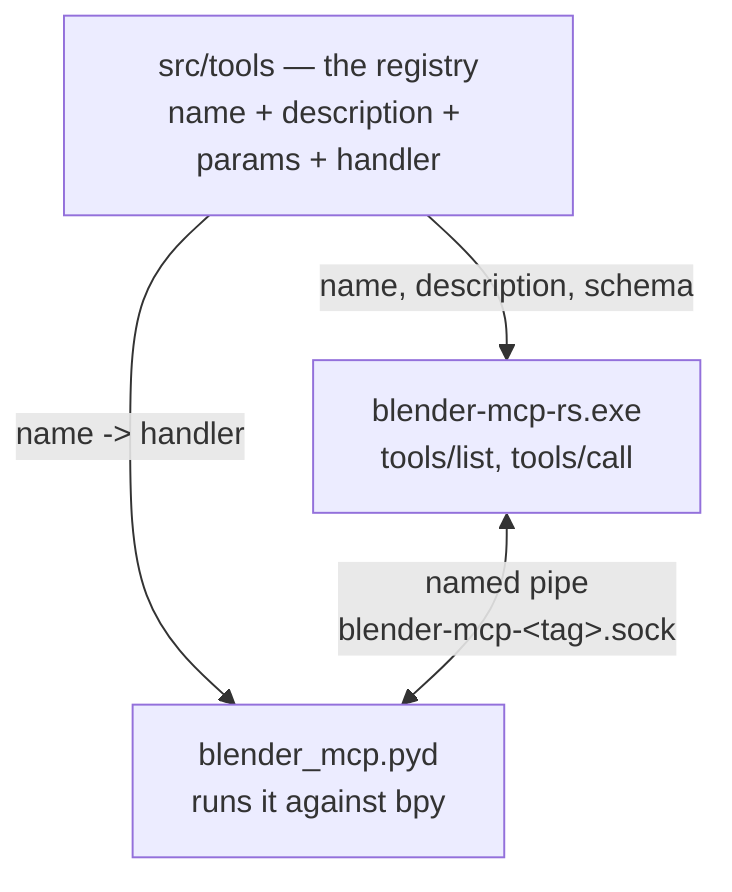
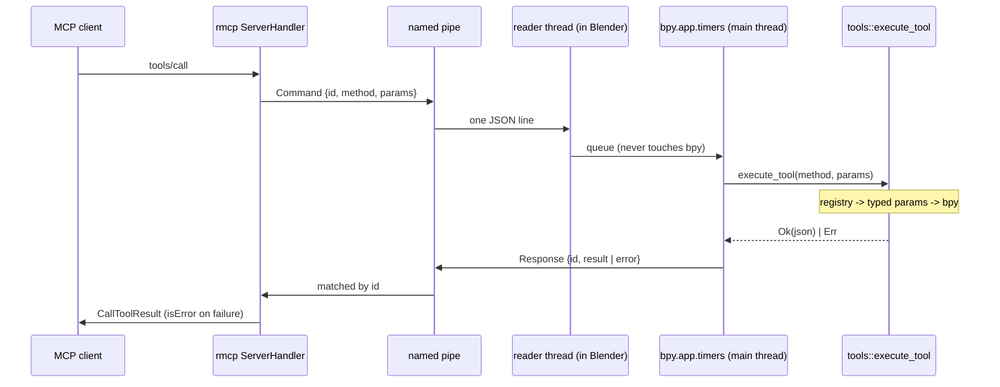

# Whitepaper — how it works

This chapter explains the architecture in full: the one idea the whole system turns on,
the transport, the threading model, the error contract, the unified node layer, and the
process-control tools. Nothing here is aspirational — it describes the code as it is.

## The core idea: one registry, two processes

A tool is declared **once**, in `src/tools/`, with its name, description, typed
parameters, and handler:

```rust
crate::tool!(
    "obj_list",
    "List objects. Filter by type or collection",
    ObjList,
    |py: Python<'_>, p: ObjList| { /* bpy */ }
);
```

The JSON Schema the model sees is **generated from the parameter struct** by
[`schemars`](https://docs.rs/schemars); the doc comment on each field becomes that
property's description. Registration is automatic (via
[`inventory`](https://docs.rs/inventory)) — there is no central list to keep in sync.

That single declaration has to serve two processes that share no memory:

- the **MCP server** (`blender-mcp-rs.exe`) needs the catalog — names, descriptions,
  schemas — to answer `tools/list` and route `tools/call`. It has **no `bpy`**.
- **Blender** needs the handler — the code that runs against `bpy`. It does **not** need
  the schema.

Both are Rust, and both are built from the *same crate* using
`crate-type = ["cdylib", "rlib"]`: the crate compiles once into the server binary and
once into `blender_mcp.pyd`, the extension Blender loads. So one static registry lands in
both artifacts.



The consequence is the whole point: **the schema and the code cannot drift apart**,
because they are the same declaration compiled into both sides. It is not a discipline
you have to uphold; it is a property of the build. The server needs no per-tool code —
one route forwards `params → pipe → Blender → result` for every tool.

## The transport

One duplex local socket carries everything: a **named pipe** on Windows, a **Unix
domain socket** elsewhere, via the [`interprocess`](https://docs.rs/interprocess) crate.
Pure Rust — no C library to build, no TCP port to bind, no firewall prompt. Framing is
newline-delimited JSON (`Command` out, `Response` back).


The **server listens**; **Blender connects** and retries forever. Two consequences fall
out of that asymmetry for free:

- **Start order does not matter.** Launch the server or Blender first — Blender keeps
  retrying until the pipe is there.
- **Blender survives a server restart.** A new server simply accepts a fresh connection.

`--tag` names the pipe (`blender-mcp-<tag>.sock`), so several Blender instances can be
driven independently from one machine.

> **Why not ZeroMQ?** The original transport was ZeroMQ over two TCP loopback ports. It
> was replaced to drop the C dependency (no FFI), the port binding, and the firewall
> prompt. The pipe is pure Rust and needs none of them.

## The threading model

`bpy` **is not thread-safe.** Touching it from any thread but Blender's main thread
crashes Blender — and a native crash cannot be caught by a `Result`, so this is a rule,
not a preference.

The pipe's reader thread therefore **only queues** incoming commands; it never calls
`bpy`. Blender's own `bpy.app.timers` callback drains that queue on the **main thread**
and executes each tool there.



## The error contract

A failed tool call returns **`Err`**, which the server turns into an MCP error with
`isError` set. It is *never* returned as a successful result whose text merely mentions an
error — the model reads right past that, and a test guards against it.

The one exception is deliberate: in a **batch** tool, a single bad item is *data*, not a
failure. Its error stays in the `results` array and the call as a whole still succeeds.

Tool code may not panic: `unwrap` / `expect` / `let _ =` on a fallible operation are
banned, because a panic inside Blender takes down more than the one tool.

## The unified node layer

Blender 5.2 has **570 node types** (shader 101, geometry 267, compositor 91, texture 37,
function 56, plus 18 generic ones like NodeGroup and NodeFrame). Rather than hand-list them — which goes stale and gets socket names wrong —
one small family of tools reads the truth from Blender itself via its RNA introspection:

```
node_types(kind, search)     search the 555 creatable node types
node_schema(type, props)     a type's REAL sockets, properties and enums
node_graph_build(tree, ...)  build a whole graph in ONE call, auto-laid-out
node_graph_get / _edit       read it back, patch it
node_group_make / _add       reusable subgraphs
mat_preview(material)        render it and look at it
```

This matters because **Blender 5 renamed most sockets**: Principled BSDF's `Specular` is
now `Specular IOR Level`, `Emission` split into `Emission Color` + `Emission Strength`,
`Transmission` → `Transmission Weight`. A model asked to guess will guess the 4.x names
and be wrong. `node_schema` hands back the *actual* sockets, so the model looks instead of
guessing; a wrong socket name is an error that returns the node's real sockets.

Trees are addressed by one string: `material:Rust`, `world`, `compositor`,
`group:MyGroup`, `object:Cube/GeoNodes`.

## Process control — a second class of tool

Five tools (`blender_status`, `blender_launch`, `blender_quit`, `blender_kill`,
`blender_restart`) are different from all the rest: they run **in the server process**,
not inside Blender. They have to. You cannot launch Blender through a pipe that only
exists once Blender is running, and you cannot ask a hung Blender to die politely over
that same pipe.

They act on the OS process via the internal `blender-control` crate (pure `std` +
`sysinfo`, no `bpy`, no MCP). `rmcp_bridge` dispatches a control tool here and everything
else to the pipe; both appear together in one `tools/list`.

Two subtleties, each paid for in debugging:

- **`launch` gives the child null stdio.** An inherited server *stdout* is the MCP
  channel — Blender's console spam would corrupt the protocol — and an undrained inherited
  *stderr* fills the ~64 KB pipe buffer and hangs Blender mid-startup.
- **A launched Blender's handle is authoritative for status.** The process table is
  consulted only for a Blender the user started by hand; otherwise the user's own open
  Blender would be conflated with ours, making `quit`/`status` lie.

`blender_launch` writes the `autostart.py` script (baked into the binary) to a temp file
and hands it to Blender with `--python`, so a launched Blender connects on its own without
the add-on being enabled in Preferences first. In `--background` Blender runs no event
loop, so that script blocks on the main thread and drives tools inline; in GUI it
registers a timer.

## Map of the code

| Path | Role | Used by |
|---|---|---|
| `src/tools/` | **the registry** — one file per domain | both |
| `src/ipc.rs` | named-pipe transport | both |
| `src/protocol.rs` | `Command` / `Response` | both |
| `src/lib.rs` | the `.pyd`: pipe client + `execute_tool` | Blender |
| `src/main.rs` | MCP server: rmcp on stdio + pipe listener | server |
| `src/rmcp_bridge.rs` | `ServerHandler`; builds `tools/list` from the registry | server |
| `src/control.rs` | the 5 process-control tools | server |
| `src/mcp_catalog.rs` | resources and prompts **only** (no tools) | server |
| `crates/blender-control` | internal crate: pure process control | server |
| `addon/mcp_server/` | thin add-on: pipe client + timer + UI | Blender |
| `addon/autostart.py` | auto-connect script for `blender_launch` | Blender |
